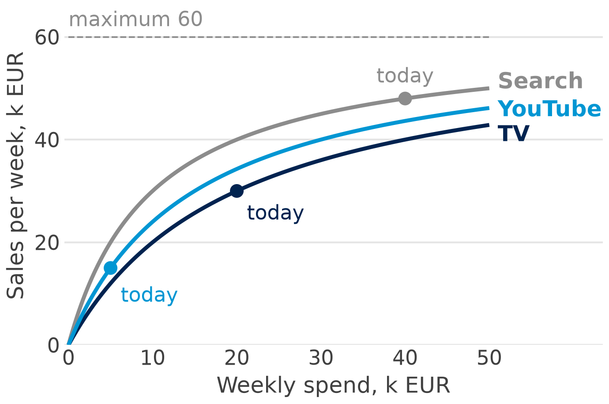

You are the analytics team that has just received a set of marketing mix model (MMM) results, and management wants a review before any money moves. The review has four short tasks: a budget move, a check of a real model, a vendor claim and a tool choice. Work in groups of three; no laptops are needed, a calculator is enough, and nothing has to be coded. Each task names the slides of the deck it builds on.

| Step | What | Time |
|---|---|---|
| 1 | **Group work** in groups of three: Tasks 1 to 4 below (about 8–9 minutes each) | 35 minutes |
| 2 | **Plenary**: two groups present Task 1, one group each Tasks 2 to 4 | 10 minutes |

**Deliverable:** one slide per group: the budget move, the verdict on Germany, the grade, the two tools.

## Task 1: where should 10 k EUR a week go?

**Budget:** three response curves of an e-bike brand: where should 10 k EUR a week go? (slide 44)

A Viennese e-bike brand (invented) advertises on TV, YouTube and Search. Its MMM gives one response curve per channel: the weekly sales a channel brings against its weekly spend (slides 9–10 and 29). All values are in k EUR a week.

{fig-alt="Three response curves, weekly spend from 0 to 50 k EUR on the x-axis and sales per week in k EUR on the y-axis. TV rises slowly and reaches 30 at today's spend of 20; YouTube rises steeply and reaches 15 at today's spend of 5; Search flattens early and reaches 48 at today's spend of 40. All three approach the maximum of 60, drawn as a dashed line." width="80%"}

| Channel | Spend now (k EUR a week) | Sales now (k EUR a week) | Average ROI | Sales at −10 k EUR | Sales at +10 k EUR |
|---|---:|---:|---:|---:|---:|
| TV | 20 | 30 | 1.50 | 20 | 36 |
| YouTube | 5 | 15 | 3.00 | – | 30 |
| Search | 40 | 48 | 1.20 | 45 | 50 |

"Sales at −10 k EUR" and "Sales at +10 k EUR" are the weekly sales of the channel if its weekly spend falls or rises by 10 k EUR. YouTube has no value at −10 k EUR because it spends only 5 k EUR a week.

The curves follow one formula: **weekly sales = 60 × spend / (spend + half-saturation)**, with a maximum of 60 for every channel and a half-saturation of 20 (TV), 15 (YouTube) and 10 (Search). Example: TV at 30 k EUR a week brings 60 × 30 / (30 + 20) = 36. Use the formula if you want more points of a curve.

*Your move:* which channel gives 10 k EUR a week, which one gets it, and why?

a. Which channel has the highest average ROI?
b. For each channel: the ROI of the next 10 k EUR and of the last 10 k EUR (extra or lost sales ÷ the euros moved).
c. The CFO allows moving 10 k EUR a week from one channel to another, total budget unchanged: which move, and how many k EUR of sales a week and a year (52 weeks) does it add?
d. Which number would you distrust first, and how would you check it before moving the money?

| Channel | Next 10 k EUR: extra sales | ROI of the next 10 k EUR | Last 10 k EUR: lost sales | ROI of the last 10 k EUR |
|---|---|---|---|---|
| TV | &nbsp; | &nbsp; | &nbsp; | &nbsp; |
| YouTube | &nbsp; | &nbsp; | &nbsp; | &nbsp; |
| Search | &nbsp; | &nbsp; | &nbsp; | &nbsp; |

::: {.answer}
*Your answer (a, c, d):*
:::

## Task 2: is the German model plausible?

**Model check:** the German model credits Google and Meta with 95 % of sales. Plausible? What would you test?

The sports brand of Part 4 also sells in its home market, Germany. The same data set holds 134 weeks of the German web shop (Jul 2021 to Feb 2024), and the same model code was run on it: the code ladder of Part 5 with "DE" instead of "AT" (slides 31–39). Sales and spend are in k EUR; ROI is sales per euro of spend, not profit.

| German model | Google | Meta | Baseline, trend and season |
|---|---:|---:|---:|
| PyMC-Marketing (Step 9): ROI, 94 % interval | 3.84 (3.26 to 4.45) | 8.99 (6.27 to 11.37) | – |
| PyMC-Marketing (Step 9): share of sales | 78.0 % | 17.2 % | 4.8 % |
| OLS with carryover (Step 6): ROI | 3.93 | 8.90 | – |
| OLS with carryover (Step 6): share of sales | – | – | 3.1 % |

Further output: 134 weeks; the sampler reported 0 divergences; the correlation of weekly sales and weekly Google spend is 0.90.

a. What does the model say in one sentence?
b. Is a baseline of about 5 % plausible for a web shop with direct visitors, newsletters and organic search?
c. Why might the model give Google too much credit? (Hint: slide 27.)
d. Propose one experiment and one change to the model, and write the two sentences you would say to the CMO.

::: {.answer}
*Your answer:*
:::

## Task 3: grade a vendor claim

**Vendor claim:** grade one case study with the four questions (slide 24)

An invented case study, written the way many real ones are:

::: {.claim}
"With our AI-powered MMM on Google Meridian, a European fashion retailer raised its marketing ROI by 45 %. Built by a certified partner; results in eight weeks."

– Source: the agency's website, 2025 (invented example)
:::

Grade the claim with the four questions of slide 24, one line each, then give a grade from A (convincing) to D (not convincing). Then: what would you ask the agency for before you believe it?

| Question (slide 24) | Your line |
|---|---|
| 1 Who wrote it? | &nbsp; |
| 2 Compared with what? | &nbsp; |
| 3 Tested how? | &nbsp; |
| 4 Which version? | &nbsp; |
| **Grade** (A convincing … D not convincing) | &nbsp; |

::: {.answer}
*What would you ask the agency for?*
:::

*Optional for fast groups:* the same four questions for a real example: "bonprix: +30 % ROI with Meridian, built by the Vienna agency e-dialog" (a claim by a partner of the tool maker, not checked independently).

## Task 4: choose a tool

**Tool choice:** PyMC-Marketing, Meridian or Robyn for two brands, with two reasons each (slide 23)

Two invented brands. For each, choose PyMC-Marketing, Meridian or Robyn and give two reasons from slides 16–23, and one risk of your choice.

- **Brand A:** a Vienna-based fashion label sells online in eight European markets; three years of weekly data in Germany and Austria, six months in Poland and Sweden; the analytics team codes in Python; the CMO wants one budget split across all markets.
- **Brand B:** an Austrian telecom operator has three years of weekly data for each of the nine Austrian federal states; most media money goes to Google search and YouTube; the team wants reach and frequency for its YouTube campaigns and a guided notebook.
- *Optional* **Brand C** for fast groups: a Polish cosmetics brand, one market, an R team, a first read-out within two weeks.

| Brand | Tool | Reason 1 | Reason 2 | One risk |
|---|---|---|---|---|
| A | &nbsp; | &nbsp; | &nbsp; | &nbsp; |
| B | &nbsp; | &nbsp; | &nbsp; | &nbsp; |
| C (optional) | &nbsp; | &nbsp; | &nbsp; | &nbsp; |

Bring your slide to the plenary.
